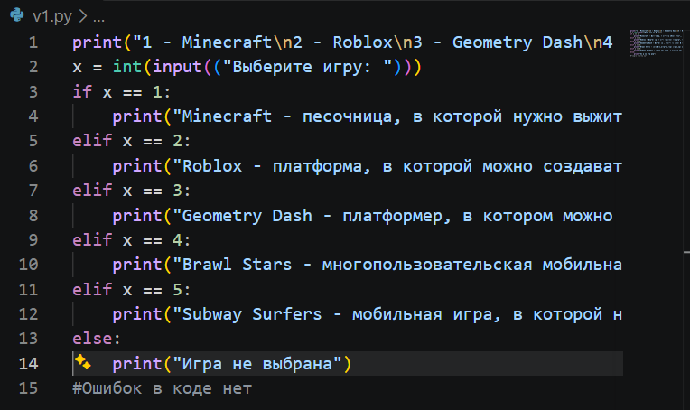
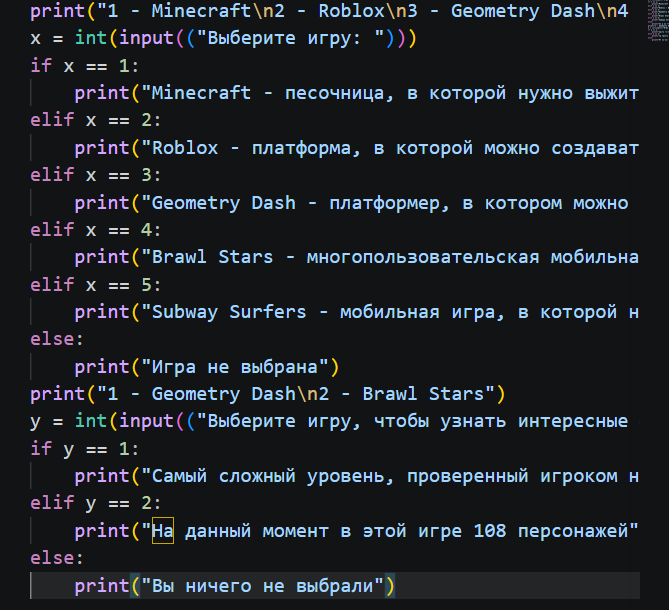
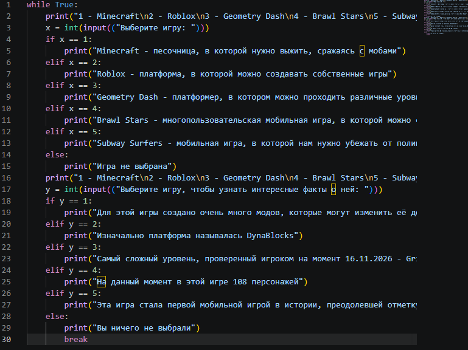

# Название проекта - Игровой Навигатор

Программа создана для того, чтобы помочь пользователю выбрать одну из пяти популярных игр и узнать о ней краткую информацию или интересный факт. Сначала она предлагает меню с описаниями игр, а затем второе меню — с любопытными фактами о каждой из них.

## Запуск

 

- [Первая версия](v1.py) -  v1.py
- [Вторая версия](v2.py) - v2.py
- [Третья версия](v3.py) - v3.py

## Команда

Аникин Олег - Менеджер проекта

## Спринт 1. План и первая версия

## Спринт 2. Доработка после показа

- **Что вошло в v2:**

## Спринт 3. Запрос на изменение и выпуск

